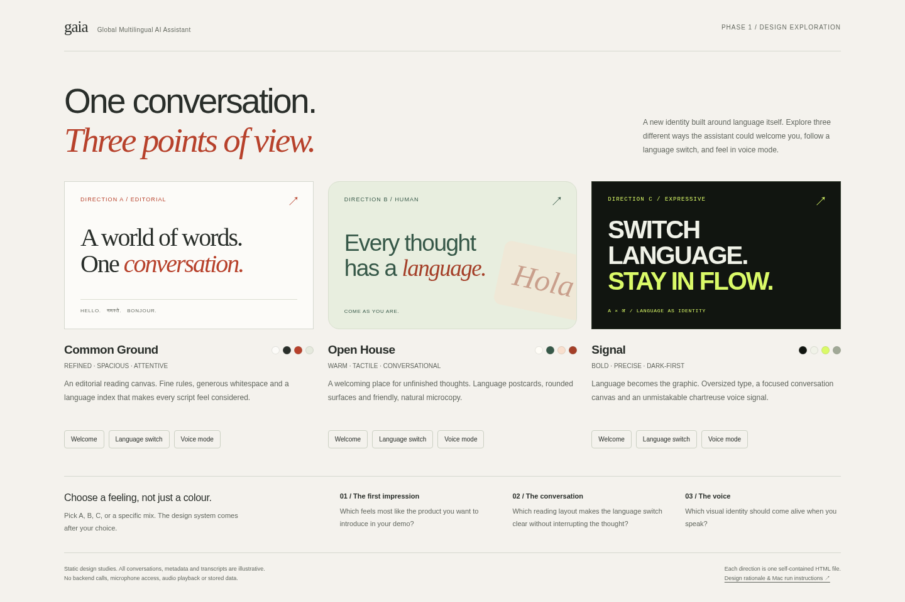

# Phase 1 — three visual directions

**Date:** 10 October 2026. **Status:** design exploration complete; awaiting a
direction choice. The Phase 0 audit was committed as `b902b15` on
`feature/redesign-v2`.

Open the comparison gallery at **http://localhost:5173/** using the command
below. Each direction contains three screens: **Welcome**, **Active chat**
with an English → German switch, and **Voice mode**. Use the top navigation or
the direct links below. Expand the palette/type/motion notes below each study.



## The three identities

### A — Common Ground

**Refined, spacious, attentive.**

- **Palette:** paper `#F4F2ED`, canvas `#FCFBF8`, ink `#292E2A`, vermilion
  `#B7412B`, sage `#E5E9DD`.
- **Type pairing:** Georgia display/reading accents with a system UI sans.
  Editorial italic is a deliberate accent, not the interface font.
- **Shapes:** fine rules, 3–4 px corners, restrained paper shadows, circular
  secondary controls.
- **Layout:** compact navigation rail, generous central reading canvas,
  language index on the welcome screen. Mobile brings the reading column
  forward and removes the secondary index.
- **Multilingual identity:** a collection of greetings, native-script
  accents and an understated vermilion language-switch rule.
- **Voice signature:** a typographic seal with greeting text around a central
  letterform; future amplitude feedback would scale its rings.
- **Motion personality (proposed):** page-turning calm; 180–240 ms fades and
  6 px entrances, 380 ms language-marker handoff. No perpetual movement is
  implemented in the static study.
- **Rationale:** emphasizes reading, thoughtfulness and credibility. The
  language transition should feel like a natural continuation of a page.

Links: [Welcome](http://localhost:5173/direction-a.html#welcome) ·
[Chat](http://localhost:5173/direction-a.html#chat) ·
[Voice](http://localhost:5173/direction-a.html#voice)

### B — Open House

**Warm, tactile, conversational.**

- **Palette:** cream `#FFFDF7`, cocoa `#352C25`, forest `#365848`, mint
  `#E6EEE1`, peach `#F8DFCE`, clay `#A43F28`.
- **Type pairing:** Avenir Next on macOS with Trebuchet/system fallbacks,
  paired with Georgia italic for human emphasis.
- **Shapes:** 16–24 px rounded surfaces, nested paper cards, shallow tactile
  shadows and soft pill controls.
- **Layout:** open welcome with conversational copy and illustrated language
  postcards; chat introduces a small conversation shelf. On mobile, postcards
  become a compact stacked illustration and prompt cards become short rows.
- **Multilingual identity:** greetings as postcards, a friendly language
  handoff chip, and a paired Latin/Devanagari voice mark.
- **Voice signature:** a soft clay-coloured rosette on a mint canvas. A future
  implementation would use actual microphone levels for its ripples.
- **Motion personality (proposed):** gentle settling; 220–280 ms entrances,
  2–4 px feedback and a 420 ms greeting/postcard handoff.
- **Rationale:** makes an unfamiliar multilingual/voice interface feel
  approachable. Microcopy invites imperfect questions and unfinished thoughts.

Links: [Welcome](http://localhost:5173/direction-b.html#welcome) ·
[Chat](http://localhost:5173/direction-b.html#chat) ·
[Voice](http://localhost:5173/direction-b.html#voice)

### C — Signal

**Bold, precise, dark-first.**

- **Palette:** graphite `#111510`, panel `#171C15`, bone `#F0F2E8`, chartreuse
  `#DAFA68`, sage-grey `#A1A997`.
- **Type pairing:** Helvetica/Arial display and UI with SF Mono/Consolas
  metadata. Oversized lettering provides the visual hierarchy.
- **Shapes:** square geometry, thin technical rules, restrained light around
  the voice state, no glass treatment.
- **Layout:** narrow tool rail, expressive central canvas and a language
  context column. Mobile prioritizes the headline, prompts and conversation;
  auxiliary context drops away.
- **Multilingual identity:** large Latin/Indic letterforms and a strong
  chartreuse language-switch signal.
- **Voice signature:** a wireframe-like orbital glyph, with a static state
  label that would remain understandable under reduced motion.
- **Motion personality (proposed):** decisive signal changes; 160–220 ms UI,
  300 ms language handoff and 420 ms panel settling.
- **Rationale:** gives the product a memorable presence on a demo screen while
  retaining a restrained, high-contrast reading area.

Links: [Welcome](http://localhost:5173/direction-c.html#welcome) ·
[Chat](http://localhost:5173/direction-c.html#chat) ·
[Voice](http://localhost:5173/direction-c.html#voice)

## What is real in these previews

These are self-contained HTML design studies with inline CSS, SVG and a small
screen-navigation script. They have no external fonts, images, runtime
dependencies, backend calls, localStorage writes, audio playback or microphone
access. The server is Python's standard-library static server.

The product name remains **Global Multilingual AI Assistant / GAIA**. The
direction names describe visual identities, not a final rename.

All conversation text, timestamps, language metadata and voice transcripts are
**explicitly illustrative**. They are not recorded backend responses or proof
of detection, answer quality, recognition or installed voices. Non-navigation
controls are shown as static design elements. The apparent Listen controls
open the voice *preview*. End returns to the chat *preview*.

No fabricated latency, token counts, confidence scores, source excerpts or
voice-availability numbers appear. No real microphone indicator is simulated
without an explicit “Mic off · static preview” label.

A and B explore light-first palettes; C explores a dark-first palette. The
chosen direction's **two deliberately designed themes**, contrast table,
production font files, usable component primitives, keyboard/focus management
and complete states belong to Phase 2 onward. System fonts may differ between
the Linux screenshots and the Mac. Named Indic fallbacks are not bundled-font
or language-support verification.

## Verification performed

Chromium **153.0.8010.12**, Playwright **1.63.0**, Python **3.12.15** in the
isolated test environment approved in Phase 0.

Temporary browser diagnostics exercised:

- Three directions × three screens × **360, 768, 1024, 1440 px**: 36 cases.
- Comparison gallery at those four widths: 4 cases.
- Welcome → chat → voice → End navigation for each direction: 3 cases.

Actual output:

```text
43/43 static preview checks passed
```

All 36 directional cases had **0 px page-level horizontal overflow**, exactly
one visible screen, correct current-navigation state, **0 page JavaScript
errors**, **0 microphone accesses**, **0 speech calls**, and **one document GET
request** with no external asset or API request. The 768 px contexts used
`prefers-reduced-motion: reduce` and reported no active animations. These are
preview/layout checks, not a completed application's parity or speech tests.

Captured and visually reviewed **20 PNGs** in `docs/screenshots/phase1/`:

- `a-{welcome,chat,voice}-{360,1440}.png`
- `b-{welcome,chat,voice}-{360,1440}.png`
- `c-{welcome,chat,voice}-{360,1440}.png`
- `gallery-{360,1440}.png`

Screenshots are full-page captures at a 900 px viewport height, so taller
mobile/reading studies show the complete composition. They do not certify
on-screen-keyboard behavior or production composer docking.

### Existing application suites rerun

```text
pytest -q tests
.....................                                                    [100%]
21 passed, 1 warning in 1.70s

tests/test_code_switching.py
ALL CODE-SWITCHING TESTS PASSED
```

The detector runner emitted **28 PASS lines**. The pytest warning remains the
existing Starlette/httpx deprecation. Pytest covers the 10 core and 11 API test
functions; they are not added again to an aggregate count.

The existing live-app browser suite remains blocked by the pre-existing
frontend failure documented in `../FRONTEND_AUDIT.md`:

```text
PASS                                                                 welcome screen visible on fresh load
tests/test_browser.py, line 40
page.wait_for_selector(".msg.assistant .bubble", timeout=30000)
playwright._impl._errors.TimeoutError: Page.wait_for_selector: Timeout 30000ms exceeded.
```

One check passed; the runner then aborted. No later check is claimed to have
run. No existing test selector or assertion was changed. The static preview
checks are not substituted for the broken application's browser suite.

A subsequent sandbox reset removed temporary logs, test venv and server
processes. The outputs above were captured before that reset; the committed
PNG files survived. The dependency-free preview server was restarted. A later
optional direct-file keyboard probe could not start because the temporary
interpreter had disappeared, so no separate `file://` keyboard result is
claimed. This does not change the earlier successful HTTP preview results.

No axe or Lighthouse result is claimed in this phase. These checks remain in
the user's implementation/review phases.

## macOS run instructions

### View the design directions

Open **Terminal** and run:

```bash
cd /Users/bhaveshsardana/language_agnostic_chatbot
pwd
python3 -m http.server 5173 --bind 127.0.0.1 --directory docs/design-explorations
```

Open **http://localhost:5173/** in Chrome or Safari. You should see three cards:
**Common Ground**, **Open House**, **Signal**. Open a card, then use Welcome /
Active chat / Voice mode at the top. All directions returns to the gallery.

The preview needs no active venv and no backend. Keep the Terminal running.
Ctrl+C stops this preview server. For screenshots:

```bash
cd /Users/bhaveshsardana/language_agnostic_chatbot
open docs/screenshots/phase1
```

### Rerun the existing application tests

Start FastAPI in a second Terminal:

```bash
cd /Users/bhaveshsardana/language_agnostic_chatbot
source venv/bin/activate
python -m uvicorn backend.main:app --host 127.0.0.1 --port 8000
```

In a third Terminal:

```bash
cd /Users/bhaveshsardana/language_agnostic_chatbot
source venv/bin/activate
python -m pytest -q tests
python tests/test_code_switching.py
python tests/test_browser.py
```

The old app is **http://localhost:8000/** and still has the audited startup
failure. The Flask baseline remains **http://localhost:5000/** when started
with `python app.py`. Both endpoints remain independent of this gallery.

### Common failures

| Problem | Fix |
|---|---|
| Wrong folder or gallery 404 | Run the exact `cd` above; `ls docs/design-explorations` should include `index.html` and all three `direction-*.html` files |
| Port 5173 in use | `lsof -nP -iTCP:5173 -sTCP:LISTEN`; reuse the gallery if it is already running, or stop your old preview with Ctrl+C. To use another port: `python3 -m http.server 5174 --bind 127.0.0.1 --directory docs/design-explorations`, then http://localhost:5174/ |
| Venv not activated | Not needed for the static gallery. For app tests: `source venv/bin/activate` from the project root |
| Missing Python package | The gallery uses only Python's standard library. For app tests: `python -m pip install -r requirements.txt`; approved test tools: `python -m pip install pytest==9.1.1 playwright==1.63.0`, then `python -m playwright install chromium` |
| Existing venv broken | Preserve it; use a separate `.venv` as documented in the Phase 0 audit, then run commands with that interpreter |
| Port 8000 in use | `lsof -nP -iTCP:8000 -sTCP:LISTEN`; the existing browser test requires this port, so reuse the right server or stop its owning Terminal |
| No mic permission prompt | Expected: the voice screen is a static study. Real mic work belongs to Phase 7 and requires HTTPS or localhost; the Mac voice matrix stays unfilled until tested |

## Phase boundary and choice

Files added in this phase are confined to `docs/design-explorations/` and
`docs/screenshots/phase1/`. No application routes, backend code, existing
frontend, requirements, tests or default page were changed. No files removed.

**Choose A, B, C, or a specific mix** before Phase 2. For a mix, identify the
overall identity, preferred chat layout and preferred voice treatment. Phase 2
will then build one coherent design system rather than silently selecting or
combining directions.
